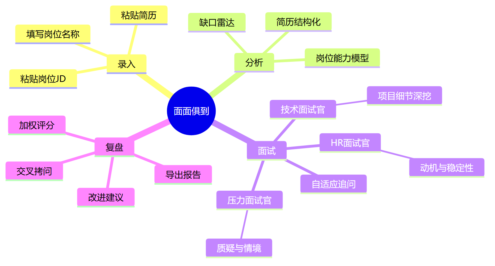
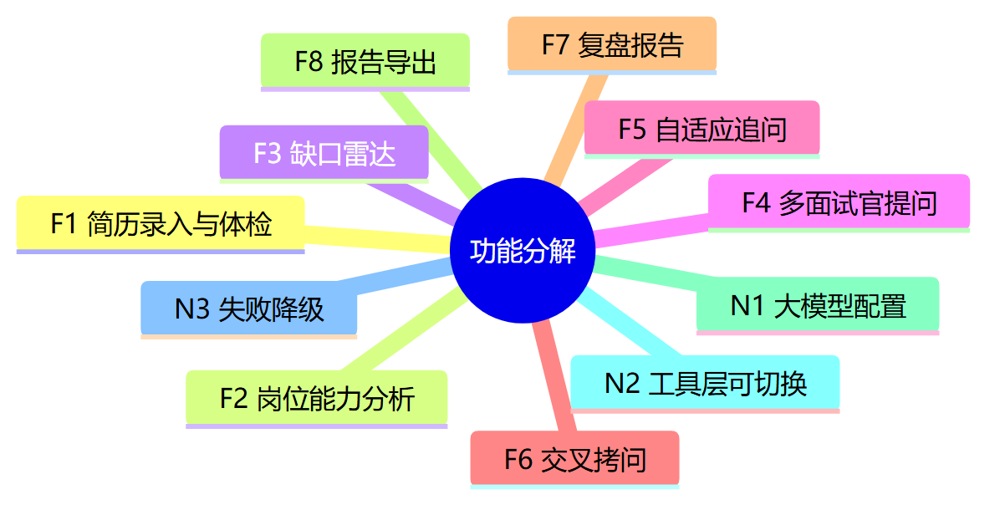
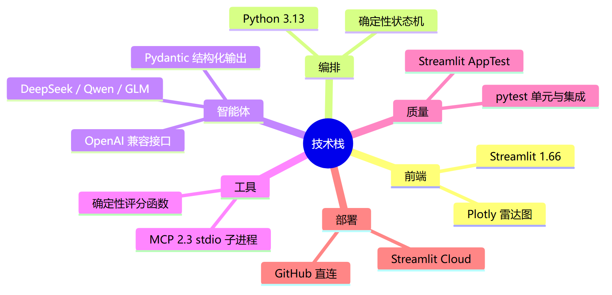
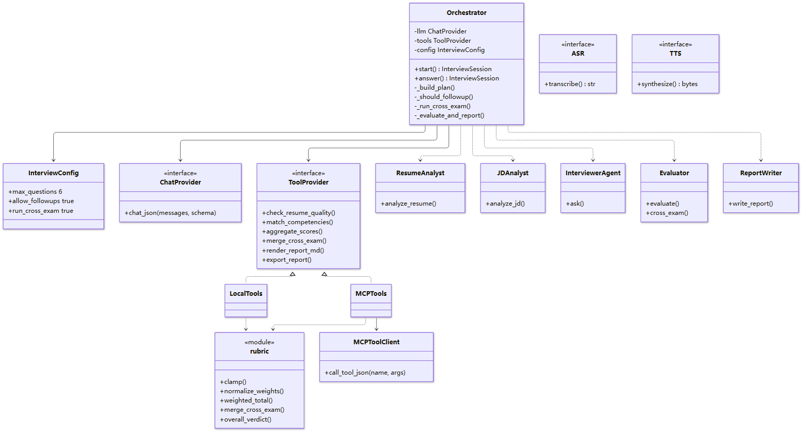
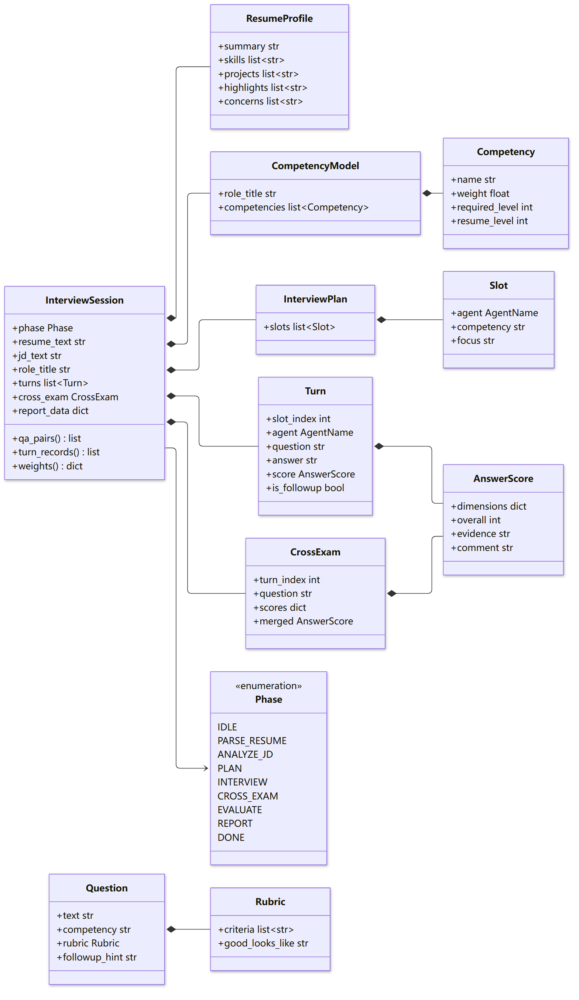
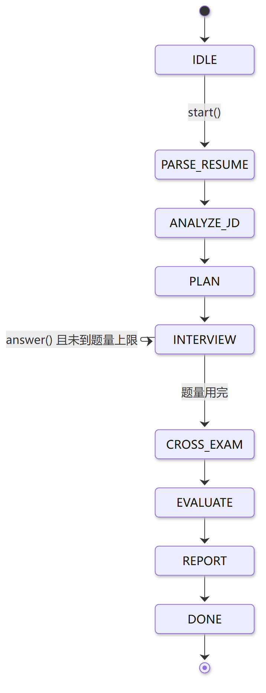

# 软件需求规格说明书

**项目名称**：面面俱到 · 模拟面试多智能体
**文档版本**：V1.2
**编写日期**：2026-10-29
**所属课程**：软件工程
**团队仓库**：https://github.com/Jiyue0321/gdut-homework4

---

## 1. 引言

### 1.1 编写目的

本文档依据 GB/T 8567《计算机软件文档编制规范》中软件需求规格说明的章节结构编写，
面向课程指导老师、助教与开发团队成员，用于：

1. 明确「面面俱到」模拟面试多智能体系统的功能边界与验收标准；
2. 作为迭代开发、测试用例编写与最终验收的依据；
3. 作为选题答辩中「需求分析」部分的支撑材料。

阅读对象：课程老师与助教（验收）、团队开发成员（实现）、答辩评委（评审）。

### 1.2 项目范围

本系统是一个面向**应届生与求职转行者**的在线模拟面试平台。用户粘贴个人简历与目标岗位 JD，
系统组织三类 AI 面试官（HR、技术、压力）围绕简历与岗位的能力缺口轮流提问，
对含糊回答自动追问，最后针对最弱的一题进行交叉拷问，输出带证据引用的复盘报告。

**范围内**：

- 简历与 JD 的文本录入与结构化分析
- 岗位能力模型抽取与「简历 × 岗位」缺口雷达
- 多面试官轮流提问、单轮自适应追问
- 交叉拷问与确定性评分聚合
- 复盘报告生成与 Markdown 导出
- Streamlit Cloud 公网部署

**范围外**（本版本不做）：硬件联动、语音输入输出（仅预留接口）、PDF 简历解析、
账号体系与多用户数据持久化、PDF 报告导出。

### 1.3 术语与缩略语

| 术语 | 说明 |
| --- | --- |
| 智能体（Agent） | 由大模型驱动、承担特定角色的无状态处理单元，如「技术面试官」 |
| 编排器（Orchestrator） | 控制器，用确定性代码管理面试阶段、题量、追问与评分聚合 |
| 编排模式 | 与「智能体自由对话」相对：流程由代码掌控，模型只负责生成内容 |
| 能力模型 | 针对岗位抽取的一组能力项及其权重、要求熟练度 |
| 缺口雷达 | 岗位要求、简历自评、面试实测三组评分叠加的雷达图 |
| 追问 | 针对同一考察点，对含糊或缺少依据的回答再问一次 |
| 交叉拷问 | 三位面试官从各自视角对同一道题独立打分，取中位数合并 |
| Rubric | 单题的评分要点与「优秀回答特征」 |
| MCP | Model Context Protocol，本项目用于把确定性工具以独立进程暴露给编排层 |
| VAD | 语音活动检测（语音功能预留，未实现） |

### 1.4 参考文档

1. GB/T 8567-2006《计算机软件文档编制规范》
2. 课程《作业要求》，2026-10-28 发布
3. 阮一峰《Commit message 和 Change log 编写指南》
4. Streamlit 官方文档：https://docs.streamlit.io
5. Model Context Protocol Python SDK 文档

### 1.5 迭代记录

| 序号 | 日期 | 版本 | 变更说明 | 修改人 |
| --- | --- | --- | --- | --- |
| 1 | 2026-10-28 | V0.1 | 建立文档骨架，确认产品定位与范围边界 | 苏炜康 |
| 2 | 2026-10-28 | V0.3 | 补充总体描述、目标用户与运行环境 | 苏炜康 |
| 3 | 2026-10-29 | V0.8 | 完成功能需求 F1–F8 与验收标准初稿 | 苏炜康 |
| 4 | 2026-10-29 | V1.0 | 补充类图、数据字典、非功能需求 | 苏炜康 |
| 5 | 2026-10-29 | V1.1 | 依据已实现功能复核全部验收标准，删除未实现项 | 苏炜康 |
| 6 | 2026-10-30 | V1.2 | 适配腾讯文档：图表改为预渲染 PNG，类图拆分为编排图与数据模型图 | 苏炜康 |
| 7 | 2026-11-05 | V2.0 | （待填）答辩前最终定稿 | （待填） |

> **使用说明（交付前请删除本段）**：迭代记录表是「文档不是最后一天赶出来」的证据，
> 请每完成一次真实修改就补一行，并如实填写日期与修改人。不要为了好看编造迭代次数。

---

## 2. 项目标志

### 2.1 产品标识

| 项目 | 内容 |
| --- | --- |
| 产品中文名 | 面面俱到 |
| 产品英文名 | MockStar |
| 一句话定位 | 让每一位求职者先被 AI 面试官「拷问」一遍，再去见真正的面试官 |
| 仓库代号 | gdut-homework4 |

### 2.2 视觉标识

- **主色**：`#2E5EAA`（沉稳蓝，象征专业与可信）
- **辅助色**：`#E8EEF7`（浅蓝底）、`#D9534F`（警示红，用于缺口提示）
- **Logo 构思**：一个由三个对话气泡围成的同心圆，三色分别代表 HR、技术、压力三位面试官，
  圆心是一个对勾，寓意「多角色交叉验证后的结论」。
- **落地要求**：Logo 需提供 PNG（512×512）与 SVG 两版，用于 PPT 封面、网页 favicon 与报告页头。
  （本版本源码中已用 emoji 🎤 作为网页图标占位。）

> **交付提示**：Logo 可用 Canva / 稿定设计 30 分钟内完成。
>
> **关于本文档中的图**：腾讯文档不支持 Mermaid 语法，因此所有图表已**预先渲染成 PNG 图片**，
> 存放在 `docs/diagrams/` 目录，直接插入腾讯文档即可。Mermaid 源文件（`.mmd`）同时保留，
> 修改后用 `docs/diagrams/README.md` 里的命令重新渲染。

---

## 3. 思维导图

### 3.1 用户旅程



> 源文件：`docs/diagrams/01-user-journey.mmd`

### 3.2 功能分解



> 源文件：`docs/diagrams/02-feature-tree.mmd`

### 3.3 技术栈



> 源文件：`docs/diagrams/03-tech-stack.mmd`

---

## 4. 总体描述

### 4.1 产品定位

市面上的面试练习产品大多停留在「题库 + 标准答案」：用户看题、背答案，却没有人像真实面试官一样
**抓住一个含糊点一直问下去**。真实面试的失败往往不是「不会」，而是「说不清、拿不出证据、
被追问三轮就崩」。「面面俱到」要解决的就是这个环节。

产品不是「面试题生成器」，而是一次**可复盘的模拟面试**：三位角色不同的面试官围绕你自己的简历出题，
对你的回答打分并给出证据，最后告诉你差在哪、两周内该做什么。

### 4.2 目标用户

| 用户类型 | 特征 | 核心诉求 |
| --- | --- | --- |
| 应届生（主要） | 有项目但表达不成体系，缺面试经验 | 提前暴露「讲不清楚」的项目细节 |
| 求职转行者 | 有工作经验但跨行业，简历与岗位不匹配 | 明确自己与目标岗位的能力缺口 |
| 求职者的同伴/学长 | 想帮人模拟面试但没时间 | 低成本、可重复的陪练工具 |

### 4.3 运行环境

| 项目 | 要求 |
| --- | --- |
| 客户端 | Chrome / Edge 最新版（桌面浏览器），无需安装 |
| 服务端 | Streamlit Cloud 免费实例；本地为 Windows 11 + Python 3.13.2 |
| 依赖 | 见 `requirements.txt`：streamlit / openai / mcp / pydantic / plotly / python-dotenv / pytest |
| 大模型 | 任意 OpenAI 兼容接口，默认 DeepSeek `deepseek-chat` |
| 网络 | 需要访问大模型 API |

### 4.4 设计与实现约束

1. **流程必须可复现**：阶段流转、题量上限、追问次数、评分聚合由确定性代码控制，
   不能交给模型自由发挥，否则演示与测试都不可控。
2. **评分的确定性**：模型只产出 rubric 与各维度分，加权、裁剪、交叉合并由 `mcp_server/rubric.py` 完成。
3. **密钥安全**：API Key 只存放在 `.env`（本地）或 Streamlit Secrets（云端），
   不得出现在仓库、日志、界面回显中。
4. **无数据库**：本版本所有会话状态保存在 Streamlit `session_state`，不落盘（导出报告除外）。
5. **工具层可降级**：MCP 子进程在云端若不可用，可切换到进程内直调，功能不变。
6. **语音可插拔**：面试引擎与界面只传递字符串，语音能力通过 Protocol 预留。

### 4.5 假设与依赖

- 假设用户提供真实、可读的简历与 JD 文本（≥ 100 字）；
- 假设大模型接口可用且配额充足；不可用时系统给出中文错误提示，不崩溃；
- 依赖 Streamlit Cloud 的可用性；冷启动可能耗时 30 秒左右。

---

## 5. 功能需求

编号规则：`F` 为功能需求，`N` 为非功能需求。每条需求均给出**可测试的验收标准**，
且都能在演示中对应到具体界面。

### 5.1 前端（界面）功能

#### F1 面试录入页

- **描述**：用户粘贴简历与岗位 JD，填写岗位名称；提供「填入示例简历 / 示例 JD」按钮，
  便于演示与快速试用。
- **输入**：简历文本（多行）、JD 文本（多行）、岗位名称（单行，可空，空则默认为「目标岗位」）。
- **输出**：进入面试分析流程。
- **验收标准**：
  1. 简历或 JD 任一为空时，「开始面试」按钮**不显示**，并提示「填写简历和 JD 后即可开始面试」。
  2. 点击「填入示例简历」后，简历文本框内容包含「广东工业大学」。
  3. 点击「填入示例 JD」后，JD 文本框内容包含「后端开发实习生」。
  4. 简历与 JD 均非空时显示「开始面试」按钮。

#### F2 面试进行页

- **描述**：以对话形式逐题展示面试官提问、用户作答与上一题评分，顶部显示进度条。
- **输入**：每轮一段回答文本。
- **输出**：下一题或进入复盘。
- **验收标准**：
  1. 顶部进度条显示「进度 x/y 题」，x 为已答题数，y 为计划题数。
  2. 当前题目上方显示面试官身份（HR 面试官 / 技术面试官 / 压力面试官），追问时标注「（追问）」。
  3. 每道已答题可展开查看「依据」与「评语」。
  4. 当前题可展开「本题考察什么」，显示考察能力、评分要点与优秀回答特征。
  5. 回答为空时提交，提示「回答不能为空」，不推进流程。

#### F3 复盘报告页

- **描述**：展示加权总分、雷达图、交叉拷问、优势、待改进、行动清单、参考答案示范与预警。
- **输入**：面试会话数据。
- **输出**：可视化报告。
- **验收标准**：
  1. 顶部显示「加权总分 x / 5」「面试用时题数」「结论」三个指标卡。
  2. 雷达图包含「岗位要求」「简历自评」「面试实测」三条曲线，量程 0–5。
  3. 交叉拷问区域显示三位面试官各自的得分与评语，以及「综合中位数」。
  4. 报告页包含「你的优势」「待改进」「行动清单」三个分区。
  5. 存在面试实测低于 2.5 的能力时，显示「需要优先补强的能力」预警。
  6. 点击「再面一次」可清空会话并回到录入页。

### 5.2 后端（智能体与工具）功能

#### F4 简历分析与岗位建模

- **描述**：简历 → 结构化事实（概要、技能、项目、亮点、疑点）；岗位 JD + 简历 → 能力模型
  （3–7 项能力，含权重与要求/现有熟练度）。
- **输入**：简历文本、JD 文本、岗位名称。
- **输出**：`ResumeProfile`、`CompetencyModel`（JSON，经 Pydantic 校验）。
- **验收标准**：
  1. 能力模型包含 3–7 项能力，权重之和归一为 1（误差 < 0.01）。
  2. 简历结构化结果中的亮点只包含有量化或结果验证的内容（提示词约束，人工抽检）。
  3. 模型输出不合法时，系统自动回喂错误重试一次，仍失败则给出中文错误提示。
  4. 首轮分析（体检 + 简历 + 岗位）在正常网络下 ≤ 20 秒。

#### F5 缺口雷达计算

- **描述**：比对岗位要求熟练度与简历自评熟练度，计算每项缺口并排序。
- **输入**：能力模型。
- **输出**：雷达图数据（每项能力的 required / resume / weight）与缺口表（gap、优先级）。
- **验收标准**：
  1. 缺口 = 要求熟练度 − 简历熟练度，仅保留正值。
  2. 缺口 ≥ 2 标记为「高」，否则为「中」；缺口表按缺口降序排列。
  3. 所有评分被裁剪到 0–5 区间。

#### F6 多面试官提问与自适应追问

- **描述**：按计划依次由 HR、技术、压力面试官出题；面试官在一次模型调用中同时完成
  「给上一题打分」与「出下一题」；当上一题回答含糊或缺乏依据时，允许对同一考察点追问一次。
- **输入**：面试计划（slot 列表）、简历结构化事实、上一轮问答。
- **输出**：单题评分（`AnswerScore`）与下一题（`Question`）。
- **验收标准**：
  1. 默认计划 6 题，面试官按 HR → 技术 → 压力循环分配。
  2. 计划优先安排缺口最大的能力。
  3. 第一题不产生评分；最后一题不再产生新题。
  4. 每个考察点最多追问 1 次；追问后题号不前进。
  5. 每轮（打分 + 出题）只调用大模型 1 次。

#### F7 交叉拷问

- **描述**：面试结束后，取出得分最低的一题，由三位面试官分别从各自视角独立打分，取中位数合并。
- **输入**：最弱一题的问题与回答。
- **输出**：`CrossExam`（三份 `AnswerScore` + 合并分）。
- **验收标准**：
  1. 交叉拷问对同一道题产生 3 份独立评分，分别标注 HR / 技术 / 压力视角。
  2. 合并分为三人中位数，且落在 0–5。
  3. 可配置关闭交叉拷问（`InterviewConfig.run_cross_exam=False`）。

#### F8 评分聚合与报告生成

- **描述**：按能力聚合逐题得分，计算加权总分与结论；由报告智能体基于结构化数据生成
  优势、待改进、行动清单与参考答案示范。
- **输入**：逐题记录、能力权重、聚合结果。
- **输出**：`report_data` 字典与自然语言复盘。
- **验收标准**：
  1. 加权总分 = Σ(能力均分 × 归一权重)，结果四舍五入保留 1 位小数。
  2. 总分 ≥ 4.0 判定「表现出色」，≥ 3.0「基本达标」，≥ 2.0「存在明显缺口」，否则「差距较大」。
  3. 行动清单恰好 3 条，且每条为两周内可执行的动作。
  4. 报告的加权总分、能力得分、结论与 `aggregate_scores` 工具的计算结果完全一致。

#### F9 报告导出

- **描述**：页面提供 Markdown 下载；工具层支持将报告写入 `workspace/` 沙箱目录。
- **输入**：报告数据。
- **输出**：`.md` 文件。
- **验收标准**：
  1. 下载文件名为「面试复盘报告.md」，编码为 UTF-8。
  2. 导出内容包含：总分、能力得分表、逐题回顾、交叉拷问表、优势、待改进、行动清单、参考答案。
  3. 沙箱写入仅允许 `.md` / `.markdown` / `.txt`，越界路径被拒绝。

### 5.3 非功能需求

#### N1 大模型配置可切换

- 支持 DeepSeek / 通义千问 / 智谱 GLM 三家 OpenAI 兼容服务，通过 `OPENAI_BASE_URL`、
  `OPENAI_API_KEY`、`OPENAI_MODEL` 切换，代码零改动。
- 配置读取优先级：Streamlit Secrets（云端）> 环境变量（本地）。
- **验收**：未配置 Key 时，页面显示「未配置大模型 API Key…」并停止，不抛异常堆栈。

#### N2 工具层可切换

- 通过 `USE_MCP` 配置在「MCP 子进程」与「进程内直调」之间切换，两者结果一致。
- **验收**：同一输入下 `MCPTools` 与 `LocalTools` 输出的缺口表一致（`tests/integration/test_mcp_server.py`）。

#### N3 失败降级与错误提示

- 模型鉴权失败 → 「大模型鉴权失败：请检查 API Key 是否正确、是否还有额度」；
- 超时 → 「大模型响应超时，请稍后重试」；
- 工具异常 → 「工具服务出错：…」。
- **验收**：上述三类错误均在界面以中文提示呈现，且页面不崩溃、可重新开始。

#### N4 质量保证

- 单元测试覆盖评分聚合、题库抽题、工具函数、状态机与提示构建；
- 集成测试用脚本化假模型跑完整面试，并使用 golden 快照校验报告格式；
- 界面流程使用 Streamlit `AppTest` 端到端验证。
- **验收**：`pytest` 全绿，slow 用例默认跳过。

#### N5 性能

- 单题「打分 + 出题」≤ 3 秒（正常网络，DeepSeek）；首次分析 ≤ 20 秒。
- **验收**：演示时抽查 3 题的平均耗时。

#### N6 安全

- API Key 不入库、不写日志、不回显；
- 报告导出限制在 `workspace/` 沙箱内，拒绝路径穿越。
- **验收**：仓库中 grep 不到任何密钥；`resolve_safe("../../etc/passwd")` 抛 `SandboxError`。

---

## 6. 外部接口需求

### 6.1 用户界面

桌面浏览器访问 Streamlit 页面，无登录。页面分为「录入页」「面试进行页」「复盘报告页」三个状态。

### 6.2 软件接口

#### 6.2.1 大模型接口

- 协议：HTTPS，OpenAI Chat Completions 兼容；
- 模式：`response_format={"type": "json_object"}` 强制 JSON 输出；
- 超时：60 秒；失败重试 1 次（校验失败时回喂错误）。

#### 6.2.2 MCP 工具接口

- 传输：stdio；启动命令 `python -m mcp_server.interview_server`；
- 工具清单：

| 工具名 | 作用 |
| --- | --- |
| `check_resume_quality` | 简历体检（板块完整性、量化成果） |
| `match_competencies` | 能力匹配与缺口计算 |
| `pick_questions` | 按能力标签抽取题库题目 |
| `list_competencies` | 列出题库覆盖的能力 |
| `aggregate_scores` | 加权评分聚合与预警 |
| `merge_cross_exam` | 交叉拷问中位数合并 |
| `render_report_md` | 渲染 Markdown 报告 |
| `export_report` | 报告写入 workspace 沙箱 |
| `get_current_time` | 当前时间 |

#### 6.2.3 语音接口（预留，未实现）

```python
class ASR(Protocol):
    def transcribe(self, audio: bytes) -> str: ...

class TTS(Protocol):
    def synthesize(self, text: str) -> bytes: ...
```

面试引擎与界面只交换字符串，后续接入浏览器 Web Speech API 时无需改动编排层。

### 6.3 通信接口

无长连接需求；每个用户操作触发一次请求—响应。

---

## 7. 数据描述

### 7.1 静态数据

**题库**（`data/question_bank.json`）：30 道题，HR 10 道、技术 12 道、压力 8 道，
覆盖 10 类能力标签：岗位动机、沟通表达、团队协作、抗压能力、学习能力、技术深度、
工程实践、系统设计、问题解决、数据意识。

### 7.2 动态数据

全部保存在会话内存（`InterviewSession`），不落盘；仅导出的报告写入 `workspace/`。

### 7.3 数据字典

| 数据项 | 类型 | 说明 | 约束 |
| --- | --- | --- | --- |
| `resume_text` | str | 简历原文 | 非空才能开始 |
| `jd_text` | str | 岗位 JD 原文 | 非空才能开始 |
| `role_title` | str | 岗位名称 | 空则默认「目标岗位」 |
| `ResumeProfile.summary` | str | 候选人背景概述 | — |
| `ResumeProfile.highlights` | list[str] | 有量化结果的亮点 | — |
| `ResumeProfile.concerns` | list[str] | 含糊/可疑点 | — |
| `Competency.name` | str | 能力名称 | 3–7 项 |
| `Competency.weight` | float | 相对权重 | ≥ 0，代码归一 |
| `Competency.required_level` | int | 岗位要求熟练度 | 0–5 |
| `Competency.resume_level` | int | 简历自评熟练度 | 0–5 |
| `Slot.agent` | enum | 面试官角色 | hr / tech / pressure |
| `Question.text` | str | 题目正文 | — |
| `Question.rubric` | Rubric | 评分要点 | criteria 2–4 条 |
| `AnswerScore.overall` | int | 单题综合分 | 0–5 |
| `AnswerScore.dimensions` | dict[str,int] | 分维度得分 | 值 0–5 |
| `AnswerScore.evidence` | str | 回答原文摘录 | — |
| `Turn.is_followup` | bool | 该题是否为追问 | — |
| `Phase` | enum | 面试阶段 | idle → … → done |
| `report_data.overall_score` | float | 加权总分 | 0–5，1 位小数 |
| `report_data.verdict` | str | 结论 | 由总分阈值决定 |

---

## 8. 类图与模块设计

### 8.1 类图

面试系统的类图按职责拆成两张：一张是**编排与智能体协作**（谁调用谁），
一张是**数据模型**（会话里存了什么）。这样在腾讯文档里插入后字号仍然可读。

#### 8.1.1 编排与智能体协作



> 源文件：`docs/diagrams/04a-class-orchestration.mmd`
>
> 读图要点：`Orchestrator` 依赖两个抽象——`ChatProvider`（大模型）与 `ToolProvider`（确定性工具），
> 因此换模型或换 MCP/本地工具都不影响编排逻辑；五个智能体用虚线（依赖）连向编排器，
> 表示它们是被调用的无状态函数，彼此不通信。

#### 8.1.2 数据模型



> 源文件：`docs/diagrams/04b-class-data.mmd`
>
> 实心菱形（组合）表示整体与部分同生共死：会话结束时，其下的计划、轮次、交叉拷问一并丢弃。

### 8.2 面试状态机



> 源文件：`docs/diagrams/05-state-machine.mmd`
>
> `INTERVIEW` 自环表示「未到题量上限就继续出题」；题量由 `InterviewConfig.max_questions` 控制（默认 6），
> 追问不推进阶段。

### 8.3 模块划分

| 模块 | 职责 | 关键文件 |
| --- | --- | --- |
| 编排层 | 状态机、计划、追问控制、评分聚合调用 | `agent/orchestrator.py` |
| 智能体层 | 简历、岗位、三类面试官、评估、报告 | `agent/agents/*.py`、`agent/prompts/` |
| 模型层 | JSON 结构化输出与校验重试 | `agent/llm.py` |
| 工具层 | 确定性工具与 MCP 客户端 | `agent/tools.py`、`agent/mcp_client.py` |
| 工具服务 | 评分、题库、报告渲染、沙箱 | `mcp_server/*.py` |
| 界面层 | 录入页、面试页、报告页、雷达图 | `app.py`、`ui/*.py` |
| 测试层 | 单元、集成、界面端到端 | `tests/` |
| 文档层 | 需求、架构、演示脚本 | `docs/` |

---

## 9. 验收标准汇总（演示清单）

答辩现场按下表逐项演示，每项均可在 3 分钟内点到：

| 编号 | 演示动作 | 预期结果 |
| --- | --- | --- |
| A1 | 打开录入页，不填任何内容 | 无「开始面试」按钮，显示提示 |
| A2 | 点击「填入示例简历 / 示例 JD」 | 两个文本框被填充 |
| A3 | 点击「开始面试」 | 20 秒内进入面试页，出现第一位面试官与题目 |
| A4 | 连续作答 6 题 | 进度条推进，每题可展开评分与依据 |
| A5 | 某一题故意答得含糊 | 该题被追问一次（标「（追问）」），题号不前进 |
| A6 | 面试结束 | 进入复盘报告页，显示总分与三条曲线雷达图 |
| A7 | 查看交叉拷问 | 三位面试官得分 + 综合中位数 |
| A8 | 展开「在页面上查看完整报告」 | 报告中包含交叉拷问表与行动清单 |
| A9 | 点击下载 Markdown | 得到 UTF-8 的 `.md` 文件 |
| A10 | 点击「再面一次」 | 回到录入页 |
| A11 | 故意使用错误 API Key 启动 | 显示中文鉴权错误，页面不崩溃 |

---

## 10. 附录

### 10.1 后续版本规划（不在本期验收范围）

| 版本 | 内容 |
| --- | --- |
| V2.0 | 浏览器 Web Speech API 语音作答与朗读 |
| V2.1 | PDF 报告导出 |
| V2.2 | 面试历史与能力成长曲线（SQLite） |
| V3.0 | 题库扩充至 200 题，支持按行业定制 |

### 10.2 与代码的对应关系

本文档所有验收标准均可在仓库中定位到实现或测试：

| 需求 | 实现位置 | 测试位置 |
| --- | --- | --- |
| F1 | `ui/interview.py:setup_form` | `tests/integration/test_app_flow.py` |
| F2 | `ui/interview.py:interview_body` | 同上 |
| F3 | `ui/report.py:render_report` | 同上 |
| F4 | `agent/agents/resume.py`、`jd.py` | `tests/unit/test_agents.py` |
| F5 | `mcp_server/toolkit.py:match_competencies` | `tests/unit/test_toolkit.py` |
| F6 | `agent/orchestrator.py` | `tests/unit/test_orchestrator.py` |
| F7 | `agent/orchestrator.py:_run_cross_exam` | 同上 |
| F8 | `mcp_server/rubric.py`、`agent/agents/report.py` | `tests/integration/test_golden_interview.py` |
| F9 | `mcp_server/toolkit.py:render_report_md/export_report` | `tests/unit/test_toolkit.py` |
| N1 | `agent/config.py` | `tests/integration/test_app_flow.py` |
| N2 | `agent/tools.py` | `tests/integration/test_mcp_server.py` |
| N6 | `mcp_server/sandbox.py` | `tests/unit/test_toolkit.py` |
